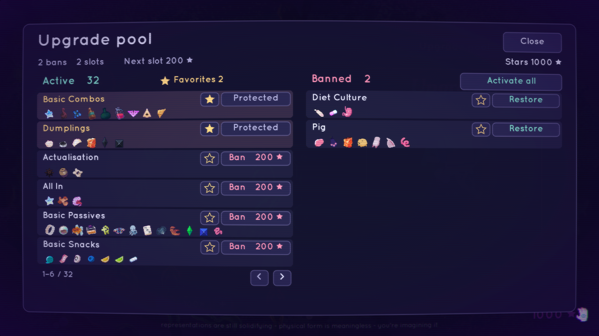
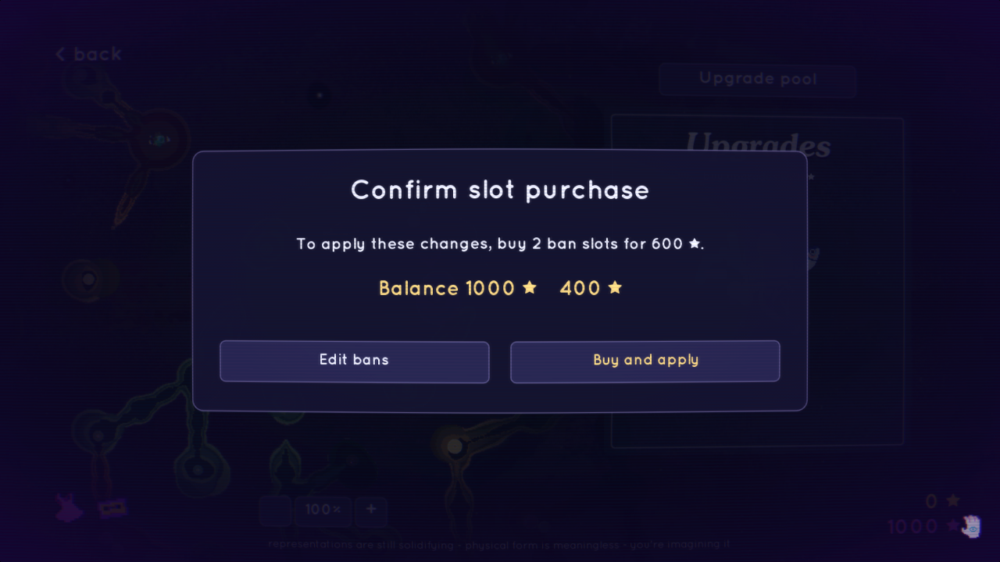

# Star Guts Pool

Manage your upgrade pool from the Star Guts menu in Dice Have No Eyes. Compatible with build `2026.11.27-76d72f4`.

## Install

Close the game. Open [unlock.lua](src/states/unlock.lua) and download the raw file. Place it at `src/states/unlock.lua` inside your save folder, creating the folders if needed.

- **Windows** `%APPDATA%\dice_have_no_eyes\`
- **Steam Deck / Proton** `steamapps/compatdata/4535880/pfx/drive_c/users/steamuser/AppData/Roaming/dice_have_no_eyes/` in your Steam library

Start the game and open **Upgrade pool** in Star Guts. To uninstall, close the game and delete the Lua file you added.

## Screenshots

